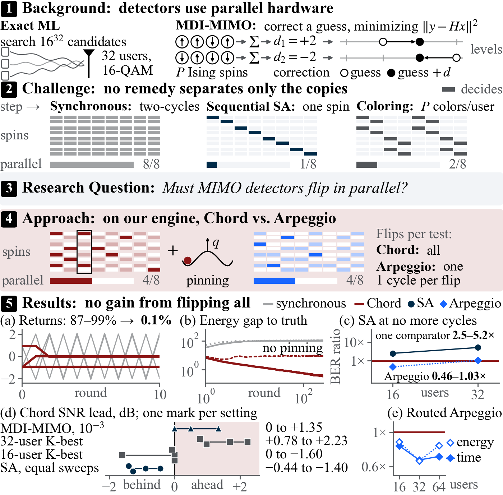
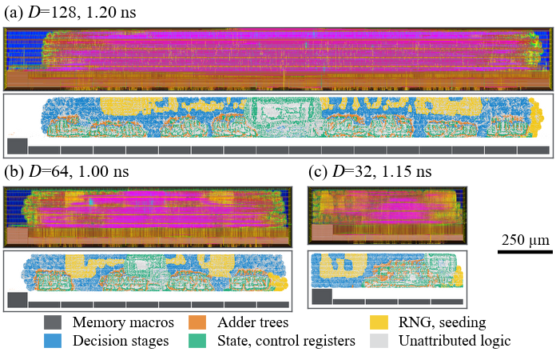
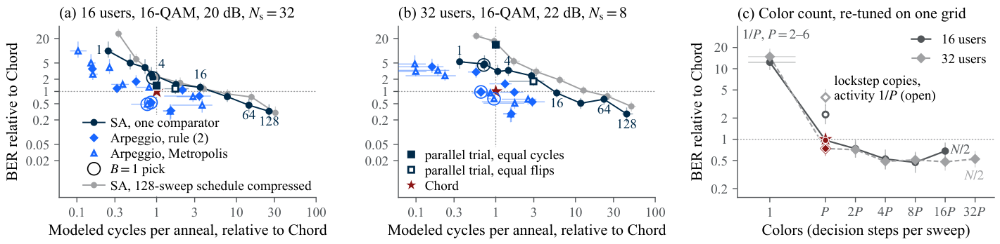
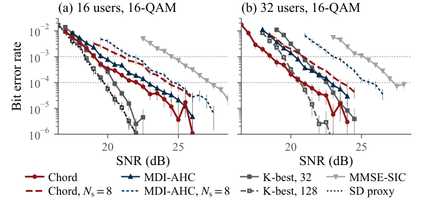

# Test in Parallel, Flip in Sequence: A Delta-Encoded Ising Engine for MIMO Detection

Official implementation of the **delta-encoded Ising engine** with its two flip policies, **Chord** and **Arpeggio**: the MIMO detection simulator and CUDA kernels, the engine RTL, the GF22 synthesis and place-and-route scripts, the result records behind the paper and the scripts for its figures.

By **Seungki Hong** and **Taekwang Jang**<br>
ETH AI Center, ETH Zurich

[](https://github.com/skethz/Arpeggio)
[](figures/)
[](#results)

> **Abstract:** Multiuser multiple-input multiple-output receivers must separate interfering streams with limited computation. Exact detection is intractable; heuristic Ising detectors often test spins at once (deciding if each flips its sign) and flip them together. Yet synchronous flips can oscillate, annealing tests one spin at a time, and each flip updates all local fields in a cycle: do parallel flips pay? Our *delta-encoded Ising engine* stores one Gram matrix for all spin copies; one active copy per coordinate (*copy coloring*) and pinning stabilize parallel flips. Two policies flip all (*Chord*) or, by the existing first-accept rule, one (*Arpeggio*) per parallel test. Within Chord's modeled cycles, parallel tests pay: 2.2–4.5 times lower bit error rates than one-at-a-time annealing at 16 and 32 users (16-ary quadrature amplitude modulation). Counterintuitively, flipping all does not: Arpeggio beats default Chord at 16 and 64 users in 16 and 28 percent less time (routed, equal clocks) and, at no more modeled cycles, re-tuned Chord at 32 and 64.

<p align="center">
  
</p>

## 📑 Contents

1. [Environment](#environment)
2. [Paper Figures and Tables](#paper-figures-and-tables)
3. [Data](#data)
4. [Code](#code)
5. [Experiments](#experiments)
6. [Results](#results)
7. [Reproducibility](#reproducibility)
8. [Citation](#citation)

## <a name="environment"></a> 📢 Environment

- Simulation: Python 3.12 with NumPy 2.5, Numba 0.68 (K-best and sphere decoder), PyTorch 2.11 (CUDA 12.8 build) and SciPy 1.18. The CUDA kernels are built to cubins with the CUDA 13.4 nvcc wheel (`nvidia-cuda-nvcc`) in the same environment (`arpeggio/mimo/build_kernel.sh`, `arpeggio/sim/build_sm120.sh`). Error counts ran on NVIDIA RTX 5090 and B200 GPUs (K-best, the sphere decoder and Chord's fixed-point model on CPUs); timed numbers come from one B200.
- RTL: Verilator for the cycle checks; Questa 2025.3 for the testbenches and the switching activity behind Table IV's power.
- Physical design: Genus and Innovus 25.11 and Conformal 25.10 with the GF22 kit (not included).
- Figures: Matplotlib 3.10, PyMuPDF 1.26, Pillow 10.4, Ghostscript 10.06 (Fig. 2 bottom) and pdfTeX with TikZ.

```bash
conda create -n arpeggio python=3.12 -y
conda activate arpeggio
pip install -r requirements.txt
pip install nvidia-cuda-nvcc==13.4.92   # Linux: CUDA kernel builds
```

## <a name="paper-figures-and-tables"></a> 🧩 Paper Figures and Tables

The figures are in [`figures/`](figures/).

| Paper | Script | Data |
| --- | --- | --- |
| Fig. 1 | [make_teaser.py](tools/figures/make_teaser.py) | `data/ber/mechanism/`, `data/ber/a55/`, `data/results/a521/`, `data/results/a519/`, `data/results/a514/`; panels (d) and (e) hold values typed from `data/ber/table2/`, `data/ber/fidelity/`, `data/ber/a5/` and `data/asic/a518/` |
| Fig. 2 (top) | [decision_flow_concept.tex](tools/figures/decision_flow_concept.tex) (pdfTeX), then [recolour_figures.py](tools/figures/recolour_figures.py) | TikZ source |
| Fig. 2 (bottom) | [make_layout.py](tools/figures/make_layout.py) | `data/layout/` |
| Fig. 3 | [make_price.py](tools/figures/make_price.py), then [recolour_figures.py](tools/figures/recolour_figures.py) | `data/ber/a5/`, `data/ber/a55/`, `data/results/a521/`, `data/results/a519/`, `data/results/a514/` |
| Fig. 4 | [make_ber.py](tools/figures/make_ber.py), then [recolour_figures.py](tools/figures/recolour_figures.py) | `data/ber/table2/` |
| Table I | – | Summary of Section V; the data of Fig. 3, Tables II–IV and `data/results/` |
| Table II | – | `data/ber/ablation/`, `data/ber/a5/`, `data/ber/a56/` |
| Table III | – | `data/ber/table2/`, `data/ber/a5/` |
| Table IV | – | `data/asic/`, `data/ber/a56/`, `data/ber/reported_comparison.json` |

The figure scripts are the ones that drew the paper's figures. In `tools/figures/`, `make_teaser.py`, `make_layout.py`, `make_price.py` and `make_ber.py` read `data/` and write to `out/`; after `pdflatex -output-directory=out decision_flow_concept.tex`, `mkdir -p final && python recolour_figures.py out final` gives Figs. 2 (top), 3 and 4, and `out/` holds Figs. 1 and 2 (bottom). All five match the PDFs in `figures/` pixel for pixel.

## <a name="data"></a> Data

| Folder | Contents |
| --- | --- |
| `data/ber/table2/` | Held-out BER curves, SNR at BER 10⁻³/10⁻⁴ with bootstrap CIs, paired SNR differences, K-best with 128 candidates. |
| `data/ber/a5/`, `a54/`, `a55/`, `a56/` | The price-of-parallelism experiments: flip policies, colorings and budgets, schedule lengths, equal-cycle SA and first-accept, early stop and the 64-user runs. |
| `data/ber/ablation/`, `mechanism/`, `regime/`, `energy/`, `equivalence/`, `fidelity/` | Ablation of copy coloring and pinning, oscillation traces, the PIMI regime map, energy inputs, kernel equivalence, and our MDI-AHC and MMSE-SIC against the published curves. |
| `data/results/` | A5.8 (64 users), A5.9 and A5.10 (RTL cycles), A5.12 (parallel-trial cost), A5.13 (fixed point), A5.14–A5.16 (commit width, re-tuned Chord at 32 users), A5.17 (k-row commits), A5.19 (re-tuned Chord at 64 users; default Chord at 64 and 16 users), A5.20 (k-row commits at 64 users), A5.21 (one-comparator SA at P1 and P2). |
| `data/asic/` | GF22 records: equivalence, static timing, activity-based power, energy per decision and fairness; A5.18 same-clock Chord/Arpeggio pairs at D = 32, 64 and 128, with their sign-off (`a518/SIGNOFF_D32_D64.md`, `a518/RESULTS_D128.md`). |
| `data/layout/` | GF22 layout exports with their [provenance](data/layout/PROVENANCE.md). |

Some data files keep earlier labels: `alternation` is copy coloring, `half_step` a round, and `ML (sphere decoder)` the sphere-decoder proxy. In `data/ber/ablation/`, (ii) alternation off, (iv) dimension-scaled pinning and (ix) sequential Metropolis SA are Table II's Copy coloring off, Coord.-scaled q (before its per-point re-tune in `data/ber/a5/a5.json`, key `c2`, `iv_retuned_P1` to `P3`) and One-comparator SA. In method keys such as `abl_far_64_0.1_0.1_0_bal_8`, `rand` is a random start and `bal` the d = 0 start (half of each coordinate's copies at +1). Parallel trial starts at random, except `abl_ptb_*` in `data/ber/a55/` (d = 0, re-tuned per point). `data/ber/table2/table2.tex` and `table2_ci.tex` are the tables Table III was made from: they add a one-stage Chord row, leave out the SA rows (from `data/ber/a5/`), and their (a)/(b) marks are not Table III's notes.

## <a name="code"></a> 🔩 Code

| Folder | Contents |
| --- | --- |
| [`arpeggio/mimo/`](arpeggio/mimo/) | Channel and detection model, the MDI wrapper, Chord's fixed-point reference and CUDA kernel (`chordfx.py`, `chord_kernel.cu`), the AHC and PIMI kernels we compare with, K-best, MMSE-SIC and the sphere-decoder proxy, tuning and BER sweeps. |
| [`arpeggio/sim/`](arpeggio/sim/) | The cycle model and flip policies (`arpx*.py`, `arpeggiofx.py`, `x3model/`), runners, supervisors and analyses of the A5.x experiments; `local_code_a5*/` hold each experiment's code, renamed to the paper's terms (placeholders, comments and unreported outputs aside). |
| [`arpeggio/rtl/`](arpeggio/rtl/) | Engine RTL: `engine/chord_engine.sv` (Chord), `engine/arpeggio_engine.sv` and `engine_a2/arpeggio_engine.sv` (Arpeggio), a behavioral memory model, testbenches and the RTL cycle checks of A5.5, A5.9, A5.10 and A5.18. |
| [`arpeggio/asic/`](arpeggio/asic/) | Synthesis (`syn/`), place and route (`pnr/`), gate-level equivalence, timing and power (`gate/`), the A5.11 and A5.18 runs and the layout export scripts (`layout/`). |

## <a name="experiments"></a> 🧪 Experiments

| Experiment | Question | Data |
| --- | --- | --- |
| Table III, ablation, regime map | BER curves; copy coloring and pinning; the PIMI regime map | `data/ber/table2/`, `ablation/`, `regime/` |
| A5–A5.3 | The price of parallelism: flip policies and colorings at matched cycles; parallel trial; sequential SA | `data/ber/a5/` |
| A5.4–A5.6 | Schedule length, equal-cycle SA and first-accept, early stop and 64 users | `data/ber/a54/`, `a55/`, `a56/` |
| A5.8 | First-accept at 64 users | `data/results/a58/` |
| A5.9, A5.10 | RTL cycles; fused first-accept | `data/results/a59/`, `a510/` |
| A5.12, A5.13 | Parallel-trial cost; fixed-point first-accept | `data/results/a512/`, `a513/`, `a513_fixed/` |
| A5.14–A5.16 | Commit width; Arpeggio against re-tuned and default Chord at 32 users; fixed point at P1, P2 and 64 users | `data/results/a514/` |
| A5.17 | Chord with k-row commits (cycle model); Arpeggio against re-tuned Chord with k-row commits at 32 users | `data/results/a517/` |
| A5.19 | Arpeggio against re-tuned Chord at 64 users; against default Chord at 64 and 16 users | `data/results/a519/` |
| A5.20 | Arpeggio against re-tuned Chord with k-row commits (k = 2, 4, all) at 64 users | `data/results/a520/` |
| A5.21 | One-comparator SA against default Chord at P1 and P2, 300,000 paired uses per point | `data/results/a521/` |
| GF22 | Equivalence, activity power, slow-corner clock and fairness of the engines | `data/asic/` |
| A5.11, A5.18 | Arpeggio through the GF22 flow: each engine at its own clock (A5.11; scripts in `arpeggio/asic/a511/`; Table IV's D = 32 Arpeggio row reuses its area and power, its own-clock ratios are not used), then at the clock of the Chord engine it is compared with (A5.18) | `data/asic/a518/` |

## <a name="results"></a> 📈 Results

### SNR (dB) at BER 10⁻³/10⁻⁴ (Table III)

| Detector | 16-QAM 16×16 | 16-QAM 32×32 | QPSK 16×16 | QPSK 32×32 |
| --- | ---: | ---: | ---: | ---: |
| MMSE-SIC | 24.5/27.2 | 25.1/27.3 | 14.7/16.8 | 14.9/17.1 |
| K-best, 32 candidates | 19.1/20.5 | 20.8/22.5 | 11.1/12.6 | 11.6/12.8 |
| Sphere-decoder proxy | 18.4/19.7 | – | 11.0/12.6 | – |
| *MDI, published anneal counts* | | | | |
| MDI-AHC | 19.6/22.8 | 20.3/22.8 | 11.8/13.7 | 13.2/15.2 |
| **Chord** | 19.0/22.1 | 18.6/20.8 | 11.1/12.6 | 10.6/12.1 |
| SA, 128 sweeps | 18.6/20.7 | – | – | – |
| *MDI, N<sub>s</sub> = 8* | | | | |
| MDI-AHC | 21.8/24.6 | 23.0/25.6 | – | – |
| **Chord** | 21.1/24.2 | 20.9/23.6 | – | – |
| SA, 128 sweeps | – | 19.6/22.7 | – | – |

–: not run. Crossing CIs are in `data/ber/table2/` and the SA rows' data in `data/ber/a5/`; footnotes are in the paper. Each sphere-decoder run reaches 100 erroneous uses or 10⁷ bits; above 18 dB at 16-QAM, the fallback for unfinished searches leaves the proxy 98 or fewer erroneous uses per point (Fig. 4 omits points with none).

### Routed GF22 Chord and Arpeggio engines, TT corner (Table IV)

| Engine | Workload | BER | Clock, TT (SS), MHz | Die, mm² | Power, mW | Time/det., µs | Energy/det., nJ | pJ/decision |
| --- | --- | --- | --- | ---: | ---: | ---: | ---: | ---: |
| Chord, D = 32 | 16×16 16-QAM, 31.02 dB, K = 1, N<sub>s</sub> = 4 | 8.7×10⁻⁴ | 870 (571) | 0.190 | 63.6 | 1.42 | 90.6 | 2.8 |
| | 16×16 16-QAM, 31.02 dB, MDI, N<sub>s</sub> = 8 | 0 obs. | | | 64.9 | 1.00 | 65.1 | 2.9 |
| | 16×16 16-QAM, 20 dB, MDI, N<sub>s</sub> = 32 | 6.7×10⁻⁴ | | | 71.1 | 77.2 | 5,490 | 2.7 |
| Chord, D = 64 | 32×32 QPSK, 14 dB, one-stage MDI, N<sub>s</sub> = 8 | 0 obs. | 1,000 (667) | 0.366 | 179 | 2.55 | 456 | 3.5 |
| | 32×32 16-QAM, 22 dB, MDI, N<sub>s</sub> = 8 | 3.7×10⁻⁴ | | | 185 | 21.8 | 4,030 | 3.4 |
| Chord, D = 128 | 64×64 16-QAM, 22 dB, MDI, N<sub>s</sub> = 8 | 3.1×10⁻⁴ | 833 (556) | 0.728 | 260 | 41.8 | 10,840 | 3.6 |
| Arpeggio, D = 32 | 16×16 16-QAM, 20 dB, MDI, N<sub>s</sub> = 32 | 3.6×10⁻⁴ | 1,000 (645) | 0.187 | 96.9 | 56.6 | 5,480 | 5.4 |
| Arpeggio, D = 64 | 32×32 16-QAM, 22 dB, MDI, N<sub>s</sub> = 8 | 3.6×10⁻⁴ | 1,000 (645) | 0.378 | 172 | 14.7 | 2,540 | 8.6 |
| Arpeggio, D = 128 | 64×64 16-QAM, 22 dB, MDI, N<sub>s</sub> = 8 | 2.7×10⁻⁴ | 833 (556) | 0.732 | 243 | 30.0 | 7,290 | 4.8 |

Arpeggio rows: the paper's B = 1 settings (a cycle budget of one times Chord's), in fixed point, on the workloads of Chord's rows 3, 5 and 6, each routed at the clock of the Chord engine it is compared with in Section V-B: 1.00 ns at D = 32 and 64, 1.20 ns at D = 128 (the D = 32 Chord row above is the 1.15 ns build; the 1.00 ns Chord at D = 32 had one closure pass). Arpeggio's cycles are those of Chord's rows 3, 5 and 6 scaled by the Section V-B RTL cycle ratios; its power is measured on 20 captured MDI sub-problems per K, as is that of the Section V-B Chord engines at the same clocks (1.00/1.00/1.20 ns: 67.2/21.8/41.8 µs per detection, 91.9/174/206 mW); on the detection streams of rows 3, 5 and 6, Chord draws 1/6/26 % more. Rows 8 and 9 had one closure pass; in row 9, one internal path misses SS hold by 0.2 ps. A decision is one test of one spin (one per spin and sweep).



### The price of parallel flips



### BER of Chord in the MDI wrapper



## <a name="reproducibility"></a> ✅ Reproducibility

- Site-specific values are placeholders: hosts `hostA`, `hostB`, `hostC`, `hostD`, `hostE`; `<SCRATCH>`, `<SCRATCH_MOUNT>`, `<USER>`, `<GPU_UUID>`, `<LOCAL>`, `<PROJECT>` and `<TOOL_LAUNCHER>`; kit names `<KIT_MACRO_PIN_LAYER>`, `<KIT_LIB_PREFIX>` and `<KIT_CELL_PREFIX>` (`arpeggio/asic/pnr/`). Scripts that contain them need them set.
- No library, LEF, technology, cell, macro or layer name of the GF22 kit is included. The synthesis script reads them from `<KIT_SYN_SETUP>`, and the place-and-route body (`arpeggio/asic/pnr/pnr_v2_body.tcl`) is appended on the server to a kit-specific prefix that is not included. The memory wrapper with the kit macros is not included; `arpeggio/rtl/engine/engine_mem_behav.sv` is its behavioral model. Layout exports contain no instance, pin or net labels.
- Logs and run directories stay on the servers.

## <a name="citation"></a> 📚 Citation

```bibtex
@misc{hong2026arpeggio,
  title = {Test in Parallel, Flip in Sequence: A Delta-Encoded Ising Engine for MIMO Detection},
  author = {Seungki Hong and Taekwang Jang},
  year = {2026},
  url = {https://github.com/skethz/Arpeggio}
}
```
