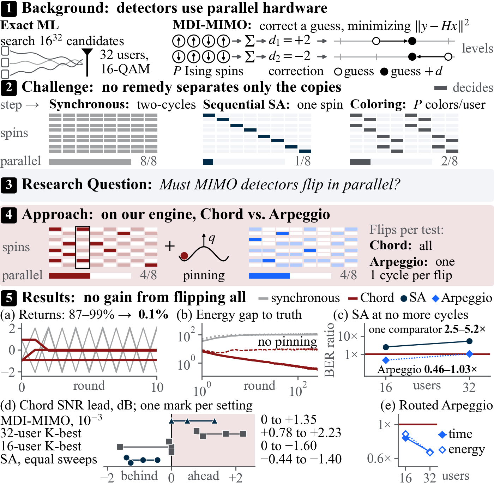
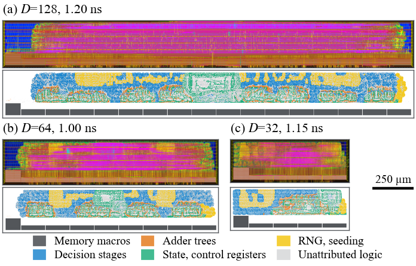
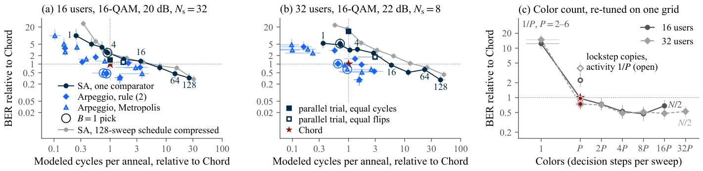
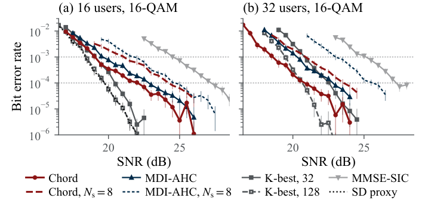

# Test in Parallel, Flip in Sequence: A Delta-Encoded Ising Engine for MIMO Detection

Official implementation of the **delta-encoded Ising engine** with its two flip policies, **Chord** and **Arpeggio**: the MIMO detection simulator and CUDA kernels, the engine RTL, the GF22 synthesis and place-and-route scripts, the result records behind the paper, the pre-registered protocols and the scripts for its figures.

By **Seungki Hong** and **Taekwang Jang**<br>
ETH AI Center, ETH Zurich

[](https://github.com/skethz/Arpeggio)
[](figures/)
[](#results)

> **Abstract:** Multiuser multiple-input multiple-output receivers must separate interfering streams with limited computation. Exact detection is intractable; heuristic Ising detectors often test spins at once (deciding if each flips its sign) and flip them together. Yet synchronous flips can oscillate, annealing tests one spin at a time, and each flip updates every local field: do parallel flips pay? Our *delta-encoded Ising engine* stores one Gram matrix for all spin copies; one active copy per coordinate (*copy coloring*) and pinning stabilize parallel flips. Two policies on it differ in flips per parallel test: all (*Chord*) or, by the existing first-accept rule, one (*Arpeggio*). Within Chord's cycles, parallel tests pay: Chord has 2.5–5.2 times lower bit error rates than one-at-a-time annealing, at 16 and 32 users (16-ary quadrature amplitude modulation). Counterintuitively, flipping all does not: Arpeggio beats Chord at 16 and 64 users and, at no more cycles, re-tuned Chord at 32; routed at equal clocks, it takes 16 percent less time at 16 users.

<p align="center">
  
</p>

## 📑 Contents

1. [Environment](#environment)
2. [Paper Figures and Tables](#paper-figures-and-tables)
3. [Data](#data)
4. [Code](#code)
5. [Experiments and Protocols](#experiments-and-protocols)
6. [Results](#results)
7. [Reproducibility](#reproducibility)
8. [Citation](#citation)

## <a name="environment"></a> 📢 Environment

- Simulation: Python 3.12 with NumPy, PyTorch 2.11 (CUDA 12.8) and SciPy. The CUDA kernels are built with the nvcc of the same CUDA wheel (`arpeggio/mimo/build_kernel.sh`, `arpeggio/sim/build_sm120.sh`). Error counts ran on NVIDIA RTX 5090 and B200 GPUs; timed numbers come from one B200.
- RTL cycle checks: Icarus Verilog or Verilator.
- Physical design: Genus and Innovus 25.11 and Conformal 25.10 with the GF22 kit (not included).
- Figures: Matplotlib, PyMuPDF and pdfTeX with TikZ.

```bash
conda create -n arpeggio python=3.12 -y
conda activate arpeggio
pip install -r requirements.txt
```

## <a name="paper-figures-and-tables"></a> 🧩 Paper Figures and Tables

Final figures are in [`figures/`](figures/).

| Paper | Script | Data |
| --- | --- | --- |
| Fig. 1 | [make_teaser.py](tools/figures/make_teaser.py) | `data/ber/mechanism/`, `data/ber/a55/`, `data/ber/table2/`, `data/ber/a5/`, `data/asic/a518/` |
| Fig. 2 (top) | [decision_flow.tex](tools/figures/decision_flow.tex) | TikZ source |
| Fig. 2 (bottom) | [make_layout.py](tools/figures/make_layout.py) | `data/layout/` |
| Fig. 3 | [make_price.py](tools/figures/make_price.py), then [recolour_figures.py](tools/figures/recolour_figures.py) | `data/ber/a5/`, `data/ber/a55/` |
| Fig. 4 | [make_ber.py](tools/figures/make_ber.py), then [recolour_figures.py](tools/figures/recolour_figures.py) | `data/ber/table2/` |
| Table I | – | Summary of Section V; the data of Fig. 3, Tables II–IV and `data/results/` |
| Table II | – | `data/ber/ablation/`, `data/ber/a5/`, `data/ber/a56/` |
| Table III | – | `data/ber/table2/`, `data/ber/a5/` |
| Table IV | – | `data/asic/`, `data/ber/a56/`, `data/ber/reported_comparison.json` |

The figure scripts are the ones that drew the paper's figures. Each reads its data through the path constants at its top, which point to the authors' tree; set them to the folders above to rerun a script.

## <a name="data"></a> Data

| Folder | Contents |
| --- | --- |
| `data/ber/table2/` | Held-out BER curves (seed 101), SNR at BER $10^{-3}$/$10^{-4}$ with bootstrap CIs, paired SNR differences, K-best with 128 candidates. |
| `data/ber/a5/`, `a54/`, `a55/`, `a56/` | The price-of-parallelism experiments: flip policies, colorings and budgets, schedule lengths, equal-cycle SA and first-accept, early stop and the 64-user runs. |
| `data/ber/ablation/`, `mechanism/`, `regime/`, `energy/`, `equivalence/`, `fidelity/` | Ablation of copy coloring and pinning, oscillation traces, the PIMI regime map, energy inputs, kernel equivalence and fixed-point fidelity. |
| `data/results/` | Later experiments by protocol: A5.8 (64 users), A5.9 and A5.10 (RTL cycles), A5.12 (parallel-trial cost), A5.13 (fixed point), A5.14–A5.16 (commit width, 32-user re-test), A5.17 (k-row commits). |
| `data/asic/` | GF22 records: equivalence, static timing, activity-based power, energy per decision and fairness; A5.18 same-clock Chord/Arpeggio pairs. |
| `data/layout/` | Accepted GF22 layout exports with their [provenance](data/layout/PROVENANCE.md). |

## <a name="code"></a> 🔩 Code

| Folder | Contents |
| --- | --- |
| [`arpeggio/mimo/`](arpeggio/mimo/) | Channel and detection model, the MDI wrapper, Chord's fixed-point reference and CUDA kernel (`anefx.py`, `ane_kernel.cu`), the AHC and PIMI kernels we compare with, K-best, MMSE-SIC and the sphere-decoder proxy, tuning and BER sweeps. |
| [`arpeggio/sim/`](arpeggio/sim/) | The cycle model and flip policies (`apx*.py`, `fafx.py`, `x3model/`), runners, supervisors and analyses of the A5.x experiments; `local_code_a5*/` hold the per-experiment copies that were frozen with each protocol. |
| [`arpeggio/rtl/`](arpeggio/rtl/) | Engine RTL: `engine/ape_engine.sv` (Chord), `engine/ape_engine_fa.sv` and `engine_a2/ape_engine_fa.sv` (Arpeggio), a behavioral memory model, testbenches and the RTL cycle checks of A5.5, A5.9, A5.10 and A5.18. |
| [`arpeggio/asic/`](arpeggio/asic/) | Synthesis (`syn/`), place-and-route flow v2 (`pnr/`), gate-level equivalence, timing and power (`gate/`), the A5.11 and A5.18 runs and the layout export scripts (`layout/`). |

Engine names in the code predate the paper: `ape`/`antiphase` is Chord, `fa` (first-accept) is Arpeggio, and `ane`/`anechoic` is the pinned synchronous rule that the paper cites.

## <a name="experiments-and-protocols"></a> 🧪 Experiments and Protocols

Every experiment was frozen in a protocol before its held-out runs. The protocols are in [`protocols/ber/`](protocols/ber/) (simulation and RTL cycles) and [`protocols/asic/`](protocols/asic/) (GF22), with their amendments and SHA-256 files.

| Experiment | Protocol | Question |
| --- | --- | --- |
| Corrective runs | [PROTOCOL.md](protocols/ber/PROTOCOL.md) | Table III rerun, ablation and the PIMI regime map |
| A5 | [PROTOCOL_A5.md](protocols/ber/PROTOCOL_A5.md) | The price of parallelism: flip policies and colorings at matched cycles |
| A5.2, A5.3 | [A52](protocols/ber/PROTOCOL_A52.md), [A53](protocols/ber/PROTOCOL_A53.md) | Extended parallel-trial grid; the stronger sequential SA |
| A5.4–A5.6 | [A54](protocols/ber/PROTOCOL_A54.md), [A55](protocols/ber/PROTOCOL_A55.md), [A56](protocols/ber/PROTOCOL_A56.md) | Schedule length, equal-cycle SA and first-accept, early stop and 64 users |
| A5.8 | [A58](protocols/ber/PROTOCOL_A58.md) | First-accept at 64 users |
| A5.9, A5.10 | [A59](protocols/ber/PROTOCOL_A59.md), [A510](protocols/ber/PROTOCOL_A510.md) | RTL cycles; fused first-accept |
| A5.12, A5.13 | [A512](protocols/ber/PROTOCOL_A512.md), [A513](protocols/ber/PROTOCOL_A513.md) | Parallel-trial cost; fixed-point first-accept |
| A5.14–A5.16 | [A514](protocols/ber/PROTOCOL_A514.md), [A515](protocols/ber/PROTOCOL_A515.md), [A516](protocols/ber/PROTOCOL_A516.md) | Commit width; 32-user re-test against re-tuned Chord; fixed-point loss at P1 |
| A5.17 | [A517](protocols/ber/PROTOCOL_A517.md) | Chord with k-row commits (cycle model) |
| GF22 gate | [PROTOCOL.md](protocols/asic/PROTOCOL.md) | Equivalence, activity power, slow-corner clock and fairness of the engines |
| A5.11, A5.18 | [A511](protocols/asic/PROTOCOL_A511_FA_GF22.md), [A518](protocols/asic/PROTOCOL_A518.md), [part 2](protocols/asic/PROTOCOL_A518_part2.md) | Arpeggio through the GF22 flow at Chord's clocks |

## <a name="results"></a> 📈 Results

### SNR (dB) at BER $10^{-3}$/$10^{-4}$, held-out seed 101 (Table III)

| Detector | 16-QAM 16×16 | 16-QAM 32×32 | QPSK 16×16 | QPSK 32×32 |
| --- | ---: | ---: | ---: | ---: |
| MMSE-SIC | 24.5/27.2 | 25.1/27.3 | 14.7/16.8 | 14.9/17.1 |
| K-best, 32 candidates | 19.1/20.5 | 20.8/22.5 | 11.1/12.6 | 11.6/12.8 |
| Sphere-decoder proxy | 18.4/19.7 | – | 11.0/12.6 | – |
| *MDI, published anneal counts* | | | | |
| MDI-AHC | 19.6/22.8 | 20.3/22.8 | 11.8/13.7 | 13.2/15.2 |
| **Chord** | 19.0/22.1 | 18.6/20.8 | 11.1/12.6 | 10.6/12.1 |
| SA, 128 sweeps | 18.6/20.7 | – | – | – |
| *MDI, $N_\mathrm{s}=8$* | | | | |
| MDI-AHC | 21.8/24.6 | 23.0/25.6 | – | – |
| **Chord** | 21.1/24.2 | 20.9/23.6 | – | – |
| SA, 128 sweeps | – | 19.6/22.7 | – | – |

–: not run. Confidence intervals and footnotes are in the paper and in `data/ber/table2/`.

### Routed GF22 Chord engines, TT corner (Table IV)

| Engine | Workload | BER | Clock, TT (SS), MHz | Die, mm² | Power, mW | Time/det., µs | Energy/det., nJ | pJ/decision |
| --- | --- | --- | --- | ---: | ---: | ---: | ---: | ---: |
| $D=32$ | 16×16 16-QAM, 31.02 dB, $K=1$, $N_\mathrm{s}=4$ | 8.7×10⁻⁴ | 870 (571) | 0.190 | 63.6 | 1.42 | 90.6 | 2.8 |
| | 16×16 16-QAM, 31.02 dB, MDI, $N_\mathrm{s}=8$ | 0 obs. | | | 64.9 | 1.00 | 65.1 | 2.9 |
| | 16×16 16-QAM, 20 dB, MDI, $N_\mathrm{s}=32$ | 6.7×10⁻⁴ | | | 71.1 | 77.2 | 5,490 | 2.7 |
| $D=64$ | 32×32 QPSK, 14 dB, one-stage MDI, $N_\mathrm{s}=8$ | 0 obs. | 1,000 (667) | 0.366 | 179 | 2.55 | 456 | 3.5 |
| | 32×32 16-QAM, 22 dB, MDI, $N_\mathrm{s}=8$ | 3.7×10⁻⁴ | | | 185 | 21.8 | 4,030 | 3.4 |
| $D=128$ | 64×64 16-QAM, 22 dB, MDI, $N_\mathrm{s}=8$ | 3.1×10⁻⁴ | 833 (556) | 0.728 | 260 | 41.8 | 10,840 | 3.6 |



### The price of parallel flips



### BER of Chord in the MDI wrapper



## <a name="reproducibility"></a> ✅ Reproducibility

- Site-specific values are placeholders: hosts `hostA`, `hostB`, `hostC`, `hostD`, `hostE`; `<SCRATCH>`, `<USER>`, `<GPU_UUID>`, `<LOCAL>`, `<PROJECT>` and `<TOOL_LAUNCHER>`. Scripts that contain them do not run until they are set.
- No library, LEF, technology, cell, macro or layer name of the GF22 kit is included. The synthesis script reads them from `<KIT_SYN_SETUP>`, and the place-and-route body (`arpeggio/asic/pnr/pnr_v2_body.tcl`) is appended on the server to a kit-specific prefix that is not included. The memory wrapper with the kit macros is not included; `arpeggio/rtl/engine/ape_mem_behav.sv` is its behavioral model. Layout exports contain no instance, pin or net labels.
- The recorded SHA-256 values in `protocols/` are over the original files. The copies here have host names, paths and instructions in chat replaced, so they do not reproduce those hashes.
- Logs and run directories stay on the servers.

## <a name="citation"></a> 📚 Citation

```bibtex
@misc{hong2026arpeggio,
  title = {Test in Parallel, Flip in Sequence: A Delta-Encoded Ising Engine for MIMO Detection},
  author = {Seungki Hong and Taekwang Jang},
  year = {2026},
  url = {https://github.com/skethz/Arpeggio}
}
```
